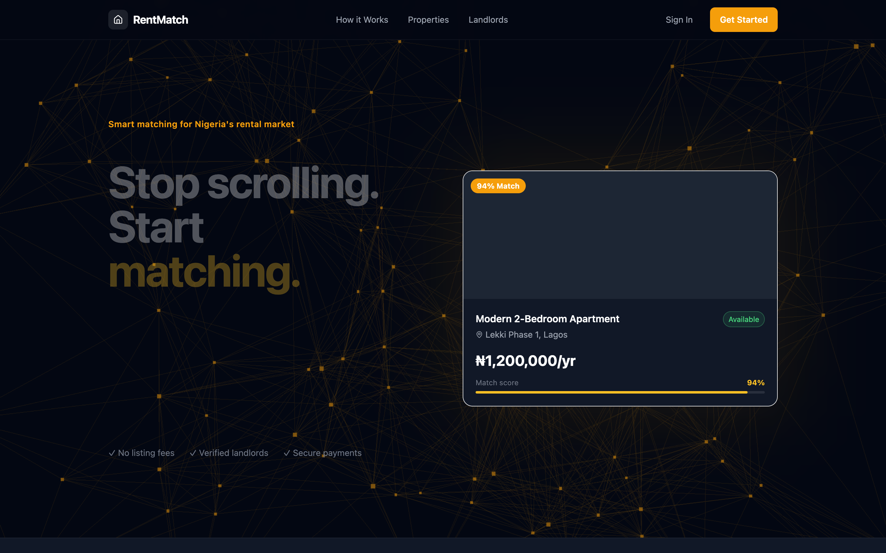
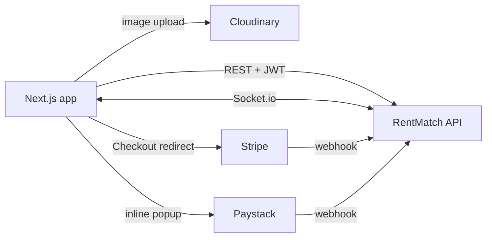

# RentMatch

**Property matching for Lagos renters, driven by optimisation instead of endless scrolling.** Tenants set their budget, area, amenities and size. The [RentMatch API](https://github.com/Olayanju-1234/rentmatch-api) ranks every listing with a linear-programming model and assigns the whole market with the Hungarian algorithm. Tenants then book a viewing with a refundable deposit paid through Stripe or Paystack.

**[Live app](https://final-year-project-frontend-sandy.vercel.app)** · API repo: [rentmatch-api](https://github.com/Olayanju-1234/rentmatch-api)



<!-- TODO: add a tenant-dashboard screenshot showing ranked matches and the Meridian assignment. -->

## What's in the app

**Tenants**
- Preference wizard: budget range, location, amenities, bedrooms and bathrooms
- Ranked matches with a score breakdown and the reasons each property fits
- "Best assignment" view from Meridian, the market-wide Hungarian assignment, with cohort size and objective value
- Map view (Leaflet), viewing calendar and in-app messaging over Socket.io
- Viewing deposits: Stripe Checkout redirect or Paystack inline popup, with a confirmation page after payment

**Landlords**
- Onboarding wizard and Stripe Connect payout setup
- Listing management with image upload to Cloudinary
- Tenant matches for their properties, analytics charts and a subscription billing portal

## Stack

Next.js 15 (App Router) · React · TypeScript · Tailwind CSS · shadcn/ui (Radix) · react-hook-form + zod · Recharts · Leaflet · socket.io-client

## How it fits together



The browser never marks a deposit as paid. The API does that only after a signature-verified webhook from Stripe or Paystack, or after checking the transaction with Paystack's verify API from the server.

## Run it locally

Requires Node.js 18+ and a running [rentmatch-api](https://github.com/Olayanju-1234/rentmatch-api).

```bash
npm install                  # then create .env.local with the variables below
npm run dev                  # http://localhost:3000
```

| Variable | Purpose |
|----------|---------|
| `NEXT_PUBLIC_API_URL` | API base URL (defaults to `http://localhost:3001/api/v1`) |
| `NEXT_PUBLIC_APP_URL` | This app's public URL (payment return links) |
| `NEXT_PUBLIC_CLOUDINARY_CLOUD_NAME` | Cloudinary cloud for listing images |
| `NEXT_PUBLIC_CLOUDINARY_UPLOAD_PRESET` | Unsigned upload preset |

## Background

RentMatch started as my final-year project on applying linear programming to tenant–property matching in Nigeria's rental market. It has since grown into a working product with real payment flows.
